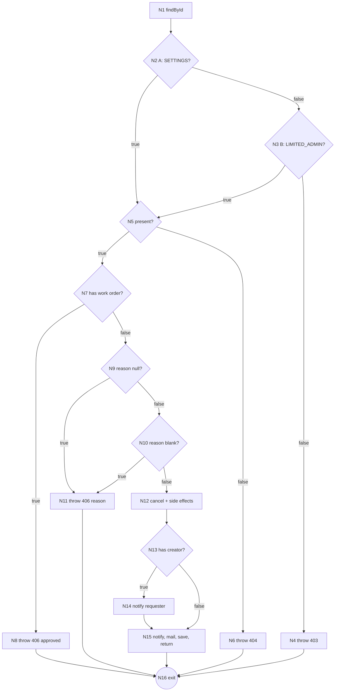

# Section 2.1 — SonarQube analysis and cyclomatic complexity

Owner: Jaweria Abdul Hameed (Area 1).

## 2.1.1 How the analysis is run

```
node tests/team/sonar/run-sonar.mjs
```

The script, `tests/team/sonar/run-sonar.mjs`, does four things:
1. Starts SonarQube Community in Docker on http://localhost:9100. Port 9000 is already used by MinIO.
2. Analyses `api/src/main` with the default **Sonar way** profile. This is project `se3002-atlas`, and it gives the project metrics in §2.1.2.
3. Analyses `RequestService` and `WorkOrderService` again as project `se3002-cc-probe`. That project uses a copy of Sonar way in which rule **java:S1541** ("Methods should not be too complex") has its threshold set to 1. SonarQube then reports the cyclomatic complexity of every method. Its normal metrics are per file only. A separate project is used so the extra issues don't change the code-smell count in §2.1.2.
4. Saves the results to `docs/evidence/sonar/project-metrics.json` and `docs/evidence/sonar/method-complexity.json`.

Test sources are not analysed. Upstream's tests are not ours, and our own coverage is reported from Section 2.3.

## 2.1.2 Project metrics

Source: `docs/evidence/sonar/project-metrics.json` (SonarQube 26.9, analysed 2026-11-27 12:12 UTC by Jaweria). Screenshots: `docs/evidence/sonar/screenshots/`.

| Metric | Value | What it shows |
|---|---|---|
| Lines of code (`ncloc`) | **41,833** | Size of the analysed code, without blank lines or comments. The other numbers should be read against this. |
| Cyclomatic complexity (`complexity`) | **5,171** across 2,294 functions (2.25 on average) | The number of independent paths through all methods together. It is the minimum number of tests needed to cover every path once. |
| Cognitive complexity | **4,148** | How hard the code is for a person to follow. Nesting and breaks in linear flow cost extra, unlike cyclomatic complexity. |
| Duplication (`duplicated_lines_density`, blocks) | **2.5 %**, 94 blocks | Share of lines that are copied elsewhere. Duplicated logic must be fixed in several places, so defects come back. |
| Code smells | **1,351** | Maintainability issues: the code works but is hard to change (long methods, unused code, naming). |
| Bugs | **114** (1 blocker, 4 critical, 85 major, 24 minor) | Code SonarQube believes behaves incorrectly at runtime (null dereferences, wrong comparisons). |
| Vulnerabilities | **215** (191 critical) | Code that can be exploited (injection, weak crypto, unsafe deserialisation). |
| Security hotspots | **0** | Security-sensitive code that a person must review. It is not necessarily a vulnerability. |
| Coverage | **0.0 %** | Share of lines and branches executed by tests. It is 0 % here because no test results are imported yet. Our own coverage is reported from Section 2.3 and in CI. |
| Technical debt (`sqale_index`, debt ratio) | **12,210 min** (about 203 h, or 25 eight-hour days); debt ratio **1.0 %** | Estimated time to fix all code smells, and that time as a share of the time to write the code. |
| Ratings (maintainability, reliability, security, security review) | Maintainability **A**, Reliability **E**, Security **D**, Security review **A** | A (best) to E (worst). Each is driven by the worst issue in its category: one blocker bug gives Reliability E. |

**What the numbers mean for our module**

- **Complexity is low on average and concentrated in a few places.** 2.25 per function means most methods are simple getters, setters and mappings. The rule logic sits in a few large methods: `RequestService.approveInternal` (9) and `cancel` (8), which is why those are our unit-test and mutation targets.
- **Reliability E comes from one blocker bug outside our scope.** It is `PartService.java:439`, where `@Transactional` settings conflict. The most common bug, 78 of 114, is java:S3655: `Optional.get()` without checking `isPresent()`. Two are in our scope:
  - `RequestService.java:430` (approve) and `:492` (cancel) look up the request's creator with `.get()`.
  - If that user no longer exists, the call throws `NoSuchElementException` (HTTP 500) instead of completing the decision. This is a candidate defect for the API tests.
- **Security D comes from 191 critical issues, 189 of them rule java:S4684 (mass assignment).** Controllers bind JSON request bodies directly onto database entities, so a client can set fields it should not control. This matches the hidden `demo` field on sign-up (Section 1) and is followed up in the security assessment. The other critical findings are CSRF protection disabled in `WebSecurityConfig.java:52` and `SwaggerSecurityConfig.java:18`. That is normal for a stateless JWT API, but it must be justified.
- **Maintainability A despite 1,351 code smells.** The rating is based on the debt ratio: 1.0 % is well under the 5 % limit for A. The smells are many but small relative to a 41,833-line code base.
- **Duplication of 2.5 % is low.** It is below the 3 % Sonar way uses for new code.
- **Coverage is 0.0 % because no test results were imported into this analysis.** Upstream's tests are not ours, and test sources were excluded. Coverage of our in-scope code is measured from Section 2.3 and enforced in CI.
- **There are no security hotspots,** so the security review rating is A by default.

## 2.1.3 Hand-calculated cyclomatic complexity: `RequestService.cancel`

**Why this function.** `cancel` (`api/src/main/java/com/grash/service/RequestService.java:456-516`)
holds three of our four business rules:
- BR-1, line 458: who may decide;
- BR-2, line 463: an approved request cannot be rejected;
- BR-4, line 466: a reason is required.

It is the most rule-dense function in the module.

### Decision points

Each compound condition is split into its simple conditions, because Java evaluates `||` with short
circuit: the second operand is a separate decision that runs only when the first is false.

| # | Line | Simple condition | Rule |
|---|---|---|---|
| D1 | 458 | `A`: role's view permissions contain `SETTINGS` | BR-1 |
| D2 | 458 | `B`: role code equals `LIMITED_ADMIN` (evaluated only if A is false) | BR-1 |
| D3 | 461 | the request exists (`optionalRequest.isPresent()`) | — |
| D4 | 463 | the request already has a work order (`getWorkOrder() != null`) | BR-2 |
| D5 | 466 | `reason == null` | BR-4 |
| D6 | 466 | `reason.trim().isEmpty()` (evaluated only if `reason` is not null) | BR-4 |
| D7 | 491 | the request has a creator (`getCreatedBy() != null`) | — |

### Control-flow graph

There are 16 nodes. Throws and the return all lead to one exit node.

| Node | Lines | Content |
|---|---|---|
| N1 | 457 | `findById(id)` |
| N2 | 458 | D1: `A`? |
| N3 | 458 | D2: `B`? |
| N4 | 459 | throw 403 "Forbidden" |
| N5 | 461 | D3: present? |
| N6 | 515 | throw 404 "Request not found" |
| N7 | 462-463 | D4: has work order? |
| N8 | 464 | throw 406 "Request is already approved" |
| N9 | 466 | D5: `reason == null`? |
| N10 | 466 | D6: `reason` blank? |
| N11 | 467 | throw 406 "Please give a reason" |
| N12 | 468-489 | mark cancelled, run workflows, webhook, build mail list |
| N13 | 491 | D7: has creator? |
| N14 | 492-498 | notify the requester |
| N15 | 500-514 | notify limited admins, send mail, save, return |
| N16 | — | exit |



### Calculation

The graph has 22 edges:
- N1→N2;
- N2→N5, N2→N3;
- N3→N5, N3→N4;
- N4→N16;
- N5→N7, N5→N6;
- N6→N16;
- N7→N8, N7→N9;
- N8→N16;
- N9→N11, N9→N10;
- N10→N11, N10→N12;
- N11→N16;
- N12→N13;
- N13→N14, N13→N15;
- N14→N15;
- N15→N16.

| Method | Working | V(G) |
|---|---|---|
| Edges and nodes | V(G) = E − N + 2 = 22 − 16 + 2 | **8** |
| Predicate nodes | V(G) = P + 1 = 7 (N2, N3, N5, N7, N9, N10, N13) + 1 | **8** |

### Comparison with SonarQube

| | Hand calculation | SonarQube (java:S1541, `method-complexity.json`) |
|---|---|---|
| `RequestService.cancel` | 8 | 8 ("The Cyclomatic Complexity of this method "cancel" is 8") |

**The two agree.** Three points explain why:

1. **SonarQube counts each `&&` and `||` as an extra decision.** This is the same as splitting compound conditions into simple ones, as above. If each `if` were drawn as one node, V(G) would be 6, which undercounts the paths: A=false with B=true is a different path from A=true.
2. **Lambdas are separate functions.** `cancel` contains five lambdas (lines 473, 488, 489, and two on 502-503). Two of them use `&&` (lines 489 and 502). SonarQube does not add them to `cancel`'s complexity. Counting them would give 10. The anonymous `HashMap` subclass at line 505 has no decisions. Our CFG likewise treats each lambda call as a single statement inside N12 and N15.
3. **`throw` statements add no complexity.** Every throw ends a path at the exit node, as in our graph.

### Basis paths

V(G) = 8, so 8 linearly independent paths cover every edge. They are built by taking a baseline
path and flipping one decision at a time. These paths become unit-test cases in Section 2.3.

| Path | Decisions | Route | Expected result |
|---|---|---|---|
| P1 (baseline) | A=T, present, no WO, reason "Duplicate", creator set | N1-N2-N5-N7-N9-N10-N12-N13-N14-N15-N16 | cancelled, reason stored, requester notified |
| P2 | flip D1: A=F, B=T | N1-N2-N3-N5-N7-N9-N10-N12-N13-N14-N15-N16 | as P1 (Limited Admin may decide) |
| P3 | flip D2 on P2: A=F, B=F | N1-N2-N3-N4-N16 | 403 Forbidden, nothing saved |
| P4 | flip D3: not present | N1-N2-N5-N6-N16 | 404 Request not found |
| P5 | flip D4: has WO | N1-N2-N5-N7-N8-N16 | 406 Request is already approved |
| P6 | flip D5: reason null | N1-N2-N5-N7-N9-N11-N16 | 406 Please give a reason |
| P7 | flip D6: reason "   " | N1-N2-N5-N7-N9-N10-N11-N16 | 406 Please give a reason |
| P8 | flip D7: no creator | N1-N2-N5-N7-N9-N10-N12-N13-N15-N16 | cancelled, no requester notification |
