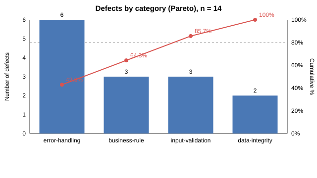

# Section 2.7 — Defects, root-cause analysis and Pareto

Owner: Mohsin Khan (defect lead).

## 2.7.1 Defect management

All defects are GitHub Issues in this repository, with one label from each group:

| Group | Labels |
|---|---|
| Type | `type:defect` (expected behaviour not met), `type:weakness` (wrong status code or missing validation) |
| Severity | `severity:critical`, `major`, `minor`, `trivial` |
| Priority | `priority:P1` (this release), `P2` (next release), `P3` (when convenient) |
| Status | `status:new` → `triaged` → `fixed` → `verified` (then closed) |
| Triage decision | `triage:fix-now`, `defer`, `wont-fix` |
| Category | `category:business-rule`, `data-integrity`, `input-validation`, `error-handling` |

Each issue states the precondition, steps to reproduce, expected and actual behaviour, the test cases that
show it, a link to the CI run, and the reason for the triage decision. Each test that shows a defect keeps
asserting the expected behaviour and is reported as a known failure until the defect is fixed
(`tests/team/api/tests/lib/known-defects.mjs`; Playwright `test.fail`).

## 2.7.2 Defect log

| Issue | ID | Title | Severity | Priority | Triage | Category | Found by |
|---|---|---|---|---|---|---|---|
| #6 | D1 | A rejected request can still be approved | major | P1 | fix now | business-rule | API-ST-07, UT-APP-12 |
| #7 | D2 | Empty or whitespace-only title accepted | minor | P2 | defer | input-validation | API title.03/04, UC1-E2 |
| #8 | D3 | PATCH replaces fields that were not sent | major | P2 | defer | data-integrity | API-PATCH-01 |
| #9 | D4 | A rejected request can be rejected again | minor | P3 | defer | business-rule | API-ST-08, REP-02 |
| #10 | D5 | A rejected request can still be edited | minor | P3 | defer | business-rule | API-ST-09 |
| #11 | D6 | Two simultaneous approvals create two work orders | major | P2 | defer | data-integrity | API-REP-01 |
| #12 | W1 | Title > 255 characters → 500 | minor | P3 | defer | error-handling | title.09 |
| #13 | W2 | Description > 10000 characters accepted | minor | P3 | defer | input-validation | description.06 |
| #14 | W3 | Number accepted for a string field | trivial | P3 | won't fix | input-validation | title.02, description.02 |
| #15 | W4 | Unknown enum value → 500 | minor | P2 | defer | error-handling | priority.05–07, assetStatus.08–10 |
| #16 | W5 | Id ≤ 0 → 404 instead of 400 | trivial | P3 | won't fix | error-handling | id.01, id.04 |
| #17 | W6 | Non-numeric id → 500 | minor | P3 | defer | error-handling | id.05, id.06 |
| #18 | W7 | Missing id in path → 500 | minor | P3 | defer | error-handling | id.07 |
| #19 | W8 | Missing reason → 500 | minor | P3 | defer | error-handling | reason.06 |

Totals: 14 issues; 3 major, 9 minor, 2 trivial. 1 is fixed now (D1, step 2.8), 11 are deferred and 2 are
"won't fix".

## 2.7.3 Pareto by category

`node tests/team/defects/pareto.mjs` reads the issues and writes `docs/evidence/defects/pareto.svg` and
`defects.json`.



| Category | Count | % | Cumulative % |
|---|---|---|---|
| error-handling | 6 | 42.9 | 42.9 |
| business-rule | 3 | 21.4 | 64.3 |
| input-validation | 3 | 21.4 | 85.7 |
| data-integrity | 2 | 14.3 | 100 |

**Reading.** Error handling (W1, W4–W8) accounts for 43 % of the defects. Error handling, business rules and
input validation together cover 86 %. The error-handling group shares one cause: client errors that reach
upstream's global exception handler are answered with 500. Fixing that handler would remove the largest
category in one change. That is the "vital few" the Pareto principle points to. The two data-integrity
defects are few, but they are the most severe (both major), so the analysis below gives them the most attention.

## 2.7.4 Root-cause analysis: D1 (#6), a rejected request can still be approved

**5 Whys**

| Why? | Answer | Evidence |
|---|---|---|
| 1. Why can a rejected request be approved? | `approveInternal` checks only `getWorkOrder() != null`; it never checks `isCancelled()`. | `RequestService.java:391` |
| 2. Why only that check? | The request's state is not one field. "Approved" is `workOrder != null` and "rejected" is `cancelled = true`, and each method guards only the field it was written for. | `Request.java:30, 44` |
| 3. Why was the guard not extended when rejection was added? | Rejection was added later (the cancellation reason column dates from changelog `2024_03_02`), and nothing ties the two flags to a single lifecycle. | `db/changelog/2024_03_02_1709332440_cancellation_reason.xml` |
| 4. Why did no test catch it? | Upstream's approve tests cover only "pending" and "already approved", with no transition *from* rejected. There is no written lifecycle to derive state-transition tests from. | `api/src/test/.../RequestServiceTest.java` ApproveTests |
| 5. Why did manual or UI use not reveal it? | The UI hides Approve and Reject once a request is cancelled, so the rule is enforced only in the browser. The server accepts the call. | `RequestDetails.tsx` (`!request.cancelled`) |

**Root cause:** an implicit state machine spread over two fields, with complete guards only in the UI.

**Fishbone (Ishikawa)**

```
  Method                       Code (machine)                 Measurement
  - no written request          - state split over two          - no state-transition tests
    lifecycle / state model       fields (cancelled, workOrder)   from "rejected"
  - status derived in the UI    - one guard per method,         - upstream tests: pending and
    only (index.tsx 317-321)      none shared                     already-approved only
              \                         |                         /
               \________________________|________________________/
                                        |
                                        +--------> D1: rejected request can be approved
               _________________________|________________________
              /                         |                         \
  People                        Environment                     Material (spec)
  - rejection added later       - UI hides the buttons, so      - no API documentation of
    by a separate change          UI testing masks the gap        allowed transitions
```

**Corrective action (this release).**
- Pull request "fix D1" adds `if (savedRequest.isCancelled()) throw 406` to `approveInternal`.
- It turns UT-APP-12 and API-ST-07 into passing regression tests, which first failed against the baseline.

**Preventive actions.**
1. Give each request one status, or a single `assertPending(request)` guard used by approve, cancel and patch. That also fixes D4 and D5.
2. Keep the state-transition suite (API-ST-01..09) in CI, so every allowed and disallowed transition is checked on every pull request.
3. Our custom mutation operator `IGNORE_APPROVAL_STATE` already checks the approved guard. A second operator for the cancelled guard is a follow-up.

## 2.7.5 Root-cause analysis: D6 (#11), two simultaneous approvals create two work orders

**5 Whys**

| Why? | Answer | Evidence |
|---|---|---|
| 1. Why are two work orders created? | Two approval transactions both see `workOrder == null` and both create one. | API-REP-01: both calls 200, two work orders with `parent_request_id` = R |
| 2. Why do both see `null`? | The check (line 391) and the write (`setWorkOrder` and `save`, lines 203-204) are separate steps. Under PostgreSQL's default READ COMMITTED isolation, neither transaction sees the other's uncommitted change. | `RequestService.java:391, 203-204` |
| 3. Why is there no lock? | `Request` has no `@Version` field (no optimistic locking), and the request is read with a plain `findById`, not `SELECT … FOR UPDATE`. | `model/Request.java`, no `@Version` |
| 4. Why does the database accept the second work order? | `work_order.parent_request_id` has a foreign key but **no unique constraint**, so "one work order per request" is not enforced in the schema. | changelog `2024_03_01_…set_null_and_cascade…xml:473` |
| 5. Why was it not found earlier? | No concurrency tests. Approval is a single-user action in manual testing, and the window is milliseconds. | Intermittent: 1 of 1, then 1 of 5 tries |

**Root cause:** a check-then-act race on the request, with no lock and no schema constraint to stop it.

**Fishbone (Ishikawa)**

```
  Method                       Code (machine)                 Measurement
  - check-then-act without      - no @Version on Request        - no concurrency tests
    locking                     - findById, not FOR UPDATE      - race is intermittent, so a
              \                         |                         single run can miss it
               \________________________|________________________/
                                        |
                                        +--------> D6: two work orders for one request
               _________________________|________________________
              /                         |                         \
  People                        Environment                     Material (schema)
  - two reviewers (Admin and    - READ COMMITTED isolation      - no UNIQUE constraint on
    Limited Admin) can act on     (PostgreSQL default)            work_order.parent_request_id
    the same queue at once
```

**Corrective action (deferred, issue #11 P2).**
- Add `@Version` to `Request`, so the second commit fails with an optimistic-locking error that maps to 409.
- Add a unique constraint on `work_order.parent_request_id`.

It is deferred because it changes the schema and the error handling, which is too large for this release.
The risk is recorded as residual in the completion report.

**Preventive actions.**
1. API-REP-01 (5 concurrent tries) stays in CI as a known failure. It starts passing once the lock exists, and then its entry is removed.
2. Code-review checklist: every "check state, then write" in a service must name its lock or constraint.

## 2.7.6 Metrics used in the weekly report (GQM)

| Metric | Value (2026-11-28) | Definition |
|---|---|---|
| Defect density | 14 / 2.508 KLOC ≈ **5.6 defects per KLOC** | issues ÷ non-comment lines of code (SonarQube `ncloc`) of the 8 in-scope API files: RequestController 97, RequestService 492, WorkOrderService 1,202, WorkOrderRepository 116, Consts 60, Helper 367, Request 61, WorkOrderBase 113 = 2,508 |
| Requirements coverage | 12 / 12 executed (100 %); 8 / 12 passing | traceability matrix |
| Reopen rate | 0 / 0 (no issue closed yet) | reopened ÷ closed |
